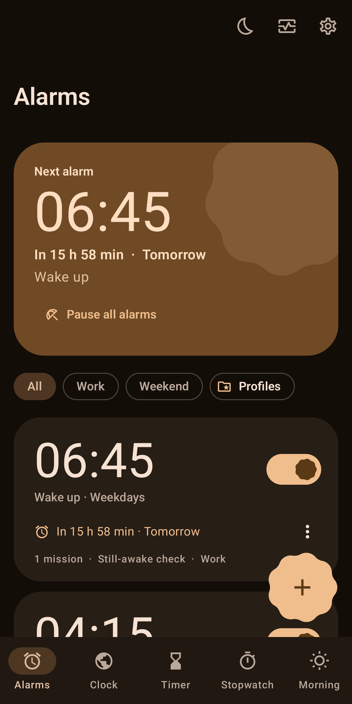
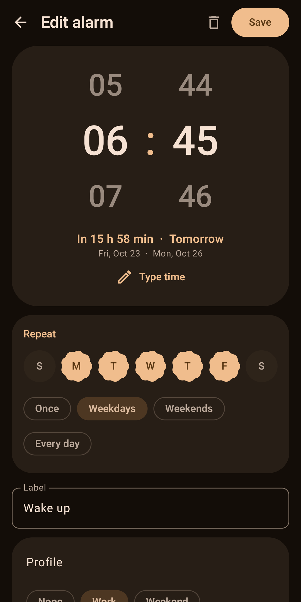
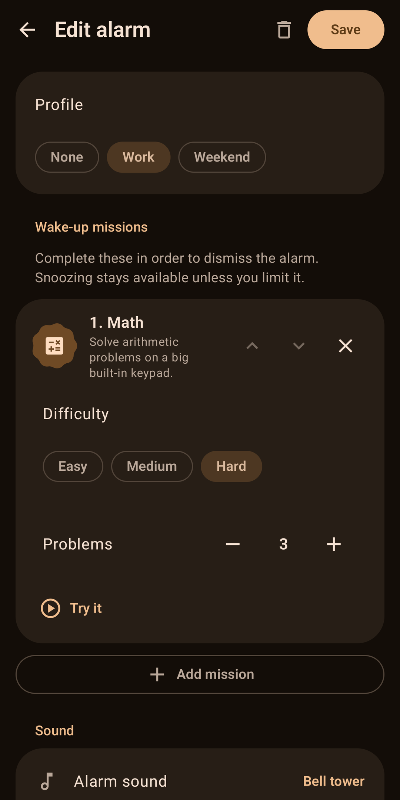
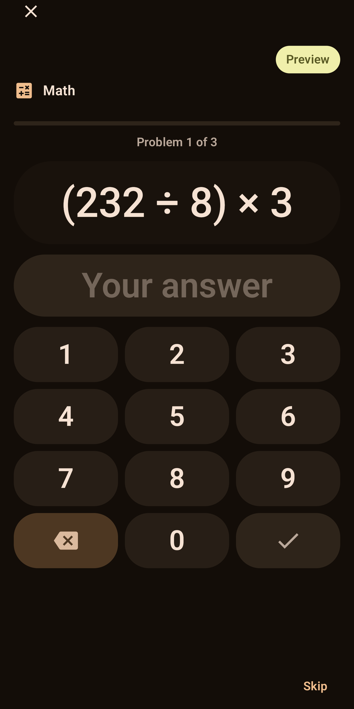
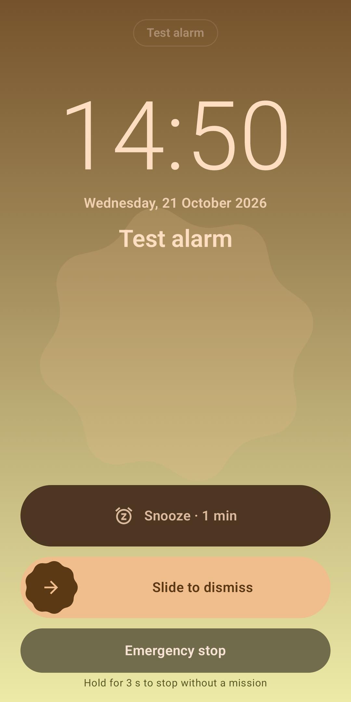
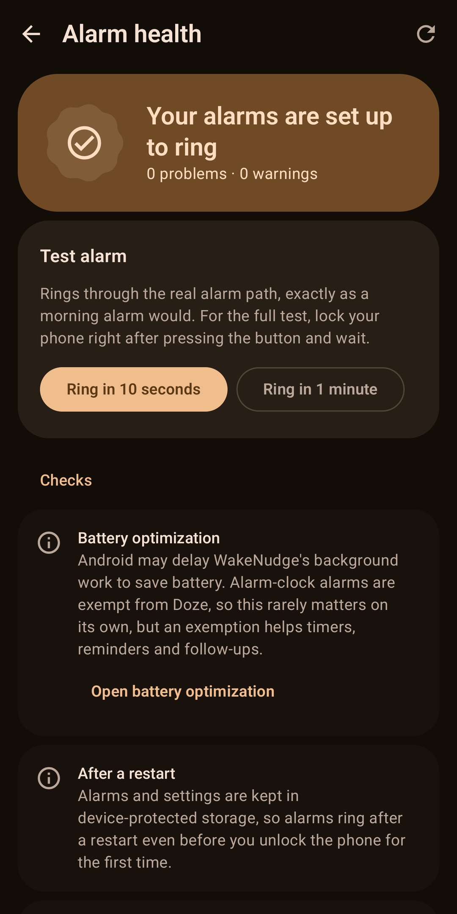
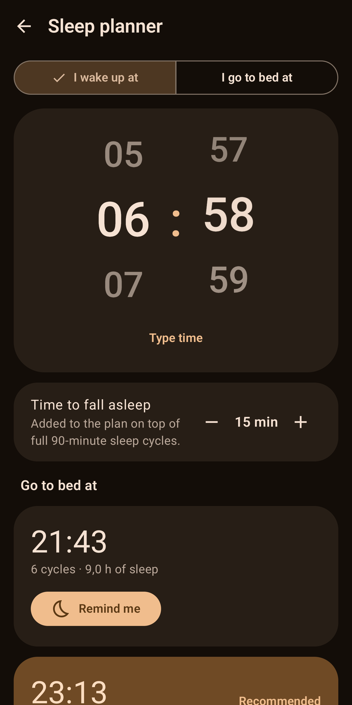
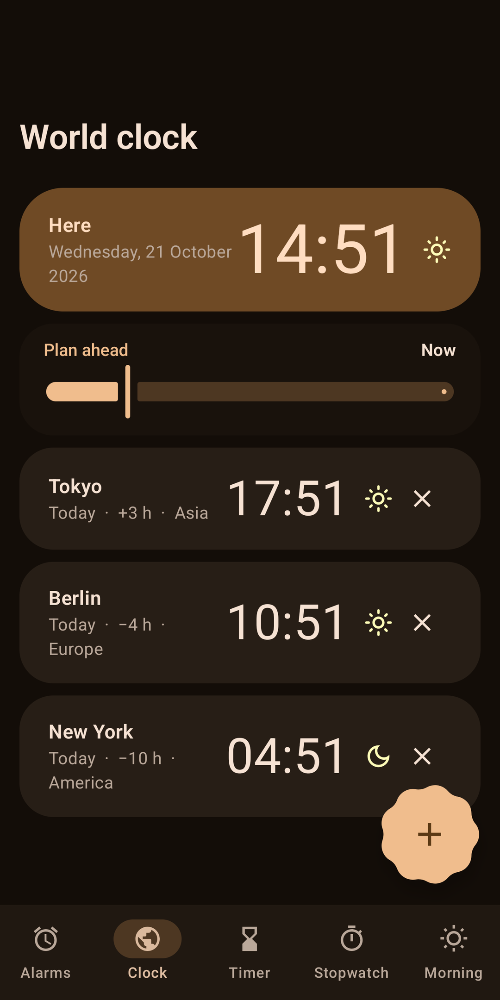

<p align="center">
  
</p>

<h1 align="center">WakeNudge: free open-source alarm clock for Android with wake-up missions</h1>

<p align="center">
  <strong>Solve a puzzle, scan a code or walk a few steps to switch it off.</strong><br>
  A reliable lock-screen alarm that checks you are really awake. Offline, no ads, no accounts, no tracking.
</p>

<p align="center">
  <a href="https://github.com/riyadmondol2006/WakeNudge/actions/workflows/ci.yml"></a>
  <a href="https://github.com/riyadmondol2006/WakeNudge/releases/latest"></a>
  <a href="LICENSE"></a>
  
  
  
  
  
</p>

<p align="center">
  <a href="https://wakenudge.site"><strong>Website</strong></a> ·
  <a href="#download">Download</a> ·
  <a href="#wake-up-missions">Missions</a> ·
  <a href="#screenshots">Screenshots</a> ·
  <a href="#privacy">Privacy</a> ·
  <a href="#faq">FAQ</a> ·
  <a href="#build-from-source">Build</a>
</p>

---

**WakeNudge** is a free, open-source alarm clock app for Android, built for heavy sleepers, shift workers, students
and anyone who has slept through an alarm. To dismiss it you complete **wake-up missions**: math problems, a QR code
or NFC tag on the other side of the room, steps, squats and more. After you dismiss, a **"Still awake?" check** rings
again if you drifted back to sleep. A built-in **Alarm Health** screen and a real **test alarm** tell you whether your
phone is set up to ring.

It runs entirely on your phone, follows your wallpaper colours with Material You, and by default an **Emergency stop** is
one press-and-hold away, so it never traps you. For an alarm you really must obey you can switch the Emergency stop
(and snooze) off, per alarm.

## Download

| Where | Status |
|---|---|
| **GitHub Releases** (APK) | [**Download the latest APK**](https://github.com/riyadmondol2006/WakeNudge/releases/latest/download/WakeNudge.apk) (starts the download straight away), or browse the [latest release](https://github.com/riyadmondol2006/WakeNudge/releases/latest). Every release carries `WakeNudge-<version>.apk` (install this one), `WakeNudge-<version>.aab` (the Play bundle), the R8 `mapping` file and `SHA256SUMS.txt`. |
| **Website** | [wakenudge.site](https://wakenudge.site): overview, screenshots, install steps and the privacy policy in one page. |

Needs **Android 8.0 (API 26) or newer**.

<details>
<summary><strong>How to install the APK and check the download</strong></summary>

1. On your phone, [download the latest APK](https://github.com/riyadmondol2006/WakeNudge/releases/latest/download/WakeNudge.apk) (or open the [latest release](https://github.com/riyadmondol2006/WakeNudge/releases/latest) and pick `WakeNudge-<version>.apk`; both are the same file).
2. Open the file. When Android asks, allow "Install unknown apps" for your browser or file manager.
3. Optional: download `SHA256SUMS.txt` next to the APK and compare, for example on a computer:

   ```bash
   sha256sum -c SHA256SUMS.txt --ignore-missing
   ```

4. Open WakeNudge, follow the short onboarding, then open **Alarm health** and ring the test alarm with your screen locked.

The GitHub APK can tell you when a newer release exists (see [Privacy](#privacy)). Updates are installed the same way, from the release page.
</details>

## Screenshots

Real captures from a Pixel 6 Pro in the dark theme. WakeNudge also has light and AMOLED themes.

<p align="center">
  
  
  
  
</p>
<p align="center">
  
  
  
  
</p>

## What makes it different

| | |
|---|---|
| **Ten wake-up missions** | Math, memory, typing, QR/barcode, NFC, shake, steps, squats, puzzles and photo matching. Chain several, pick the difficulty, preview each one. |
| **Still-awake check** | Dismissed and went back to sleep? WakeNudge asks "Still awake?" after 1 to 30 minutes and rings again if you do not answer. It survives restarts. |
| **Loud, then louder** | An **Extra Loud strength slider** (you choose how much punch to add), a volume ramp of up to 10 minutes, and a sound that intensifies after 40 seconds without interaction. A separate **backup alarm** rings later if nothing happens. |
| **Anti-oversleep, with an exit** | Snooze limits (optionally shrinking), hold-to-dismiss, accidental-dismissal protection and an optional edit lock before the alarm. Every restriction can be bypassed with the **Emergency stop**, which is on by default; **strict alarms** can turn it, and snooze, off per alarm (missions your phone cannot do still offer Continue, and the ring timeout still ends the alarm). |
| **Alarm Health and test alarm** | Checks notifications, full-screen permission, exact alarms, battery restrictions, Do Not Disturb and audio routing, explains each fix, and rings a real test alarm. |
| **Offline, no ads, no tracking** | No accounts, no analytics, no ad SDKs. The Play build has no network permission at all. See [Privacy](#privacy). |
| **Open source** | Apache License 2.0, Kotlin and Jetpack Compose, with a large automated test suite. |
| **Material You design** | Dynamic colour, light, dark and AMOLED themes, large-text and right-to-left support, TalkBack labels, layouts that adapt to the window size. Alarm options are grouped into collapsible categories with a one-line summary of each, and Settings is a short grouped list. |

### Wake-up missions

Missions are completed in order. Count and difficulty are set per alarm. A mission the phone cannot do (no camera, no
step sensor, permission refused) offers **Continue** instead of blocking you.

| Mission | What you do | Needs |
|---|---|---|
| Math | Solve arithmetic problems on a big built-in keypad | |
| Memory | Watch tiles light up, then repeat the pattern as it grows | |
| Typing | Type a phrase exactly as shown | |
| QR code or barcode | Scan a code you registered away from your bed | Camera |
| NFC tag | Tap an NFC tag you placed away from your bed | NFC |
| Shake | Shake the phone until the counter is full | Accelerometer |
| Steps | Walk a number of steps, counted on the phone | Step counter or motion sensor |
| Squats | Do squats while holding the phone against your chest | Accelerometer |
| Puzzle | Slide tiles into order, find the numbers one to N, or trace a pattern | |
| Photo | Go to a place you photographed and point the camera at it (matched on the phone) | Camera |

A heavy-sleeper setup that works well: **QR code or NFC** (so you must leave the bed), plus the **still-awake check**,
**Extra Loud** and a **backup alarm**.

<details>
<summary><strong>Everything else it does</strong></summary>

**Alarms and schedules**
- Unlimited alarms with labels, repeat days, one-time dates and delete-after-use
- Profiles (Work, Weekend, ...), skip next ring, vacation mode, holiday and calendar exceptions, upcoming-alarm heads-up
- Alarm options are grouped into collapsible categories (wake-up challenge, sound and light, volume and vibration, snooze, oversleep protection, schedule rules) with a live summary of each; settings is a grouped hub
- Bedtime reminders and a sleep planner (wake-up time or bedtime from 90-minute sleep cycles)
- A morning dashboard with history and streaks

**Sound**
- 12 bundled tones in gentle, standard and loud tiers, each loudness-normalised to its target level (plus two internal ones for the intensify layer and backup alarms), or your own local music. Tapping a tone plays it right away
- Random tone per ring, strong vibration patterns or your own recorded rhythm
- Offline spoken announcements with the phone's text-to-speech engine
- Sunrise mode (the screen brightens gradually) and a separate backup alarm
- Hearing safety: a configurable volume cap on headphones, and the system alarm volume is restored afterwards

**Clock tools**
- Timer, stopwatch with laps, world clock, live countdown to the next alarm
- Home-screen widgets (next alarm, alarm list, clock) and a Quick Settings tile

**Data**
- Local backup and restore to a JSON file you choose, with validation and a preview before anything is replaced
</details>

## How it stays reliable

An alarm clock is judged on the one morning it fails, so this is where most of the engineering went.

- Uses the system alarm-clock API (`AlarmManager.setAlarmClock`), plays on the alarm audio stream (`USAGE_ALARM`), and runs a foreground service with a full-screen ring UI over the lock screen.
- State lives in device-protected storage, so alarms can ring after a restart before the first unlock.
- Re-arms everything after reboots, app updates, time-zone changes and daylight-saving changes. Snoozes, backup rings and the still-awake check are persisted, not just held in memory.
- One corrupt alarm cannot stop the others; the app stays under the OS limit of 500 alarms; a 6-hour watchdog re-validates the schedule.
- A fallback chain (your sound, then the default tone, then a generated beep) means a deleted song still produces sound.
- Hundreds of unit, fuzz and instrumented tests, including "how will real people break it?" suites. Details in [docs/TESTING.md](docs/TESTING.md) and [docs/ARCHITECTURE.md](docs/ARCHITECTURE.md).

**Honest limits.** WakeNudge cannot override the operating system. A phone that is switched off will not ring, and
some manufacturers' battery managers restrict background apps aggressively. So far it has been verified on **one
physical device (a Pixel 6 Pro on Android 17)**. Samsung, Xiaomi, OnePlus, other Android versions, a real power cycle and
a TalkBack walkthrough are on the "not verified" list in [docs/TESTING.md](docs/TESTING.md). Please run the test alarm
on your own phone and [report what you find](https://github.com/riyadmondol2006/WakeNudge/issues/new/choose).

## Privacy

No accounts, no ads, no analytics, no crash reporting, no tracking SDKs. Alarms, history and settings are stored
only in the app's private storage on your phone. Permissions such as camera, step counter and calendar are requested
only when you use the feature that needs them ([every permission, and why](docs/PERMISSIONS.md)).

There are two ways to get WakeNudge, and they differ in exactly one respect:

| Build | Network permission | What it does online |
|---|---|---|
| **APK from GitHub Releases** | `INTERNET` only | An **update popup** that checks GitHub at most once a day for a newer release. It sends nothing about you or your alarms, and you can switch it off in **About, then Updates**. |

Both are built from this repository. Read the full [privacy policy](PRIVACY.md).

## Why another alarm app?

Many alarm apps with wake-up challenges are closed source and show ads or ask for an account or a subscription, while
many open-source clocks stay deliberately minimal. WakeNudge aims to combine the two: a reliable alarm, real wake-up
missions, a safety net that cannot trap you unless you ask it to, and code you can read, build and audit yourself. It is made by one
developer, with original code, sounds and artwork.

## FAQ

<details>
<summary><strong>Is it really free and open source?</strong></summary>

Yes. Apache License 2.0, no ads, no subscription, no in-app purchases, no account. The whole app is in this repository.
</details>

<details>
<summary><strong>Is it really offline?</strong></summary>

The alarm clock never needs the internet. The Play build declares no network permission at all (the Gradle
`verifyOfflineManifest*` tasks fail the build if `INTERNET`, `ACCESS_NETWORK_STATE` or `ACCESS_WIFI_STATE` appears). The GitHub APK
holds only `INTERNET`, used for the optional update popup described under [Privacy](#privacy).
</details>

<details>
<summary><strong>Will the alarm ring if my phone is switched off?</strong></summary>

No app can. If the phone was off when an alarm was due, WakeNudge rings on start-up if it was due within the last 10
minutes; otherwise it records the alarm as missed, posts a notification and turns a one-time alarm off.
</details>

<details>
<summary><strong>Does it work on Samsung, Xiaomi, OnePlus and other phones?</strong></summary>

It uses Android's standard alarm-clock APIs, but it has only been tested on hardware on a Pixel 6 Pro (Android 17).
Some manufacturers add battery managers that can still stop background work. Open **Alarm health**, follow its
fixes, set WakeNudge's battery usage to unrestricted if your phone has such a setting, ring the **test alarm** with the
screen locked, and report the result.
</details>

<details>
<summary><strong>I am a heavy sleeper. What should I turn on?</strong></summary>

Use a mission that makes you leave the bed (QR code or NFC tag somewhere else, or steps), the still-awake check,
Extra Loud mode with the volume ramp, a limited number of snoozes and the backup alarm. Run the test alarm once. No app
can guarantee a wake-up, but these settings remove the easy ways to fail.
</details>

<details>
<summary><strong>Can a mission trap me?</strong></summary>

No. The Emergency stop (press and hold on the ring screen) bypasses every restriction, and a mission the phone cannot
perform offers Continue.
</details>

<details>
<summary><strong>How do updates work?</strong></summary>

The GitHub APK shows a popup when a newer release exists and you install it from the release page; you can switch the
check off in About, then Updates. The check contacts GitHub at most once a day and sends nothing about you or your
alarms.
</details>

<details>
<summary><strong>Which Android versions and languages are supported?</strong></summary>

Android 8.0 (API 26) and newer; the target is Android 17 (API 37). The interface is in English.
</details>

## Build from source

Requirements: JDK 21 and the Android SDK (platform 37), or an Android Studio release that supports Android Gradle Plugin 9.4.

```bash
git clone https://github.com/riyadmondol2006/WakeNudge.git
cd WakeNudge
./gradlew :app:assemblePlayDebug          # app/build/outputs/apk/play/debug/
./gradlew :app:testPlayDebugUnitTest      # JVM unit and fuzz tests
./gradlew :app:lintPlayDebug              # lint (must be free of errors)
./gradlew :app:verifyOfflineManifestPlayDebug   # fails if a network permission appears
```

There are two product flavours:

| Flavour | What it is | Manifest |
|---|---|---|
| `play` | The Google Play build | No network permission, no update code |
| `github` | The APK on GitHub Releases | Adds only `INTERNET`, for the update popup |

Use `assembleGithubDebug`, `testGithubDebugUnitTest` and `verifyOfflineManifestGithubDebug` for the other flavour,
and `assemblePlayRelease` / `bundlePlayRelease` for a minified release APK or AAB. Debug builds install as
`com.riyadm.wakenudge.debug` ("WakeNudge Debug") next to a release install. Release signing and the release process are
described in [docs/RELEASING.md](docs/RELEASING.md).

### Instrumented tests

> **If several devices are connected, do not run `./gradlew connectedPlayDebugAndroidTest`.** It installs on and runs
> against every attached device. Target exactly one:
>
> ```bash
> adb -s <SERIAL> install -r -t app/build/outputs/apk/play/debug/app-play-debug.apk
> adb -s <SERIAL> install -r -t app/build/outputs/apk/androidTest/play/debug/app-play-debug-androidTest.apk
> adb -s <SERIAL> shell am instrument -w -r com.riyadm.wakenudge.debug.test/com.riyadm.wakenudge.HiltTestRunner
> ```

The tests ring real alarms and use real audio. Use a test device, not the phone you sleep with.

## Project layout

```
app/src/main/java/com/riyadm/wakenudge/
  domain/    models, scheduling policies (pure Kotlin), use cases
  data/      Room, DataStore, repositories, backup
  engine/    scheduler, ring controller/service, audio, wake-check, timers, recovery
  missions/  the ten mission types and their host
  health/    Alarm Health checks and diagnostics export
  widget/    Glance widgets          tile/  Quick Settings tile
  ui/        Compose screens, theme, components
app/src/github/   manifest overlay for the GitHub flavour
docs/             documentation
```

Built with Kotlin, Jetpack Compose, Material 3, Hilt, Room, DataStore, Glance, CameraX and ZXing core.
More in [docs/ARCHITECTURE.md](docs/ARCHITECTURE.md).

## Documentation

| | |
|---|---|
| [docs/ARCHITECTURE.md](docs/ARCHITECTURE.md) | How alarms are scheduled, rung and recovered |
| [docs/TESTING.md](docs/TESTING.md) | Test strategy, what was verified on a device, what was not |
| [docs/PERMISSIONS.md](docs/PERMISSIONS.md) | Every permission, why it exists and when it is asked for |
| [PRIVACY.md](PRIVACY.md) | Privacy policy |
| [docs/PLAY_STORE.md](docs/PLAY_STORE.md) | Play Store listing, declarations and release checklist |
| [CONTRIBUTING.md](CONTRIBUTING.md) | How to contribute |
| [SECURITY.md](SECURITY.md) | How to report a vulnerability privately |
| [CHANGELOG.md](CHANGELOG.md) | Release notes |

## Contributing

Bug reports about an alarm that did not ring are the most valuable contribution: please include your phone model,
Android version, vendor skin and the **Alarm Health** report (Alarm Health, then Copy). Read [CONTRIBUTING.md](CONTRIBUTING.md)
for the ground rules (stay offline, a mission must never trap the user, restore what you change) and the checks a pull
request must pass. Everyone taking part is expected to follow the [Code of Conduct](CODE_OF_CONDUCT.md).

If WakeNudge works for you, a star on the repository helps others find it.

## License

Apache License 2.0. See [LICENSE](LICENSE) and [NOTICE](NOTICE). To cite the project, see [CITATION.cff](CITATION.cff).
