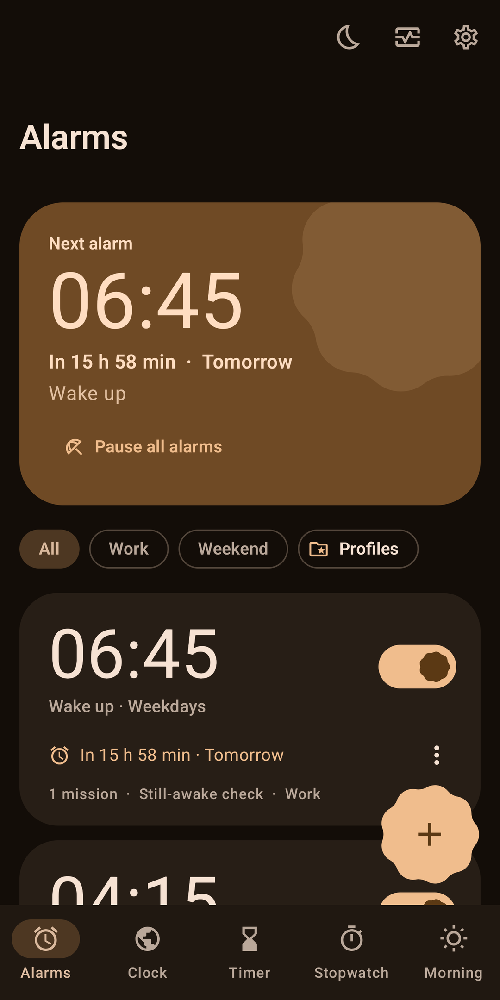
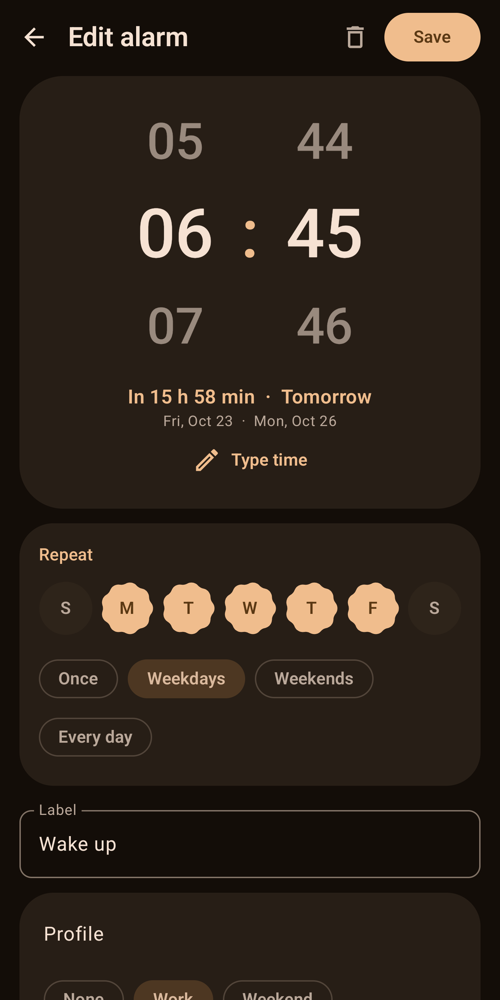
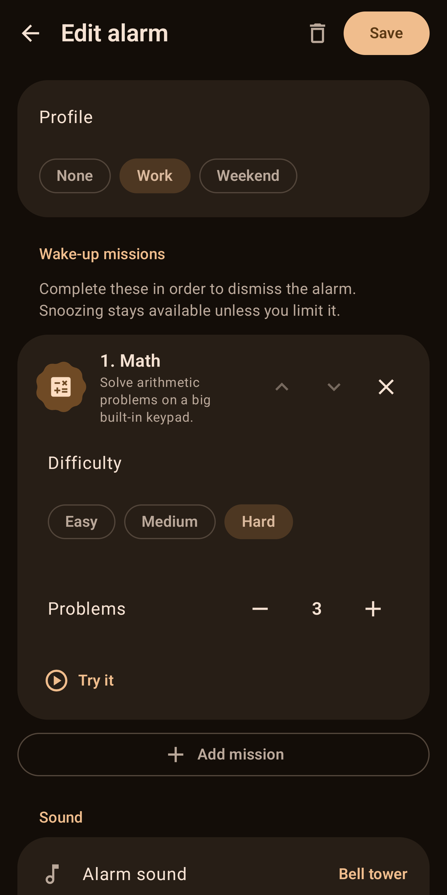
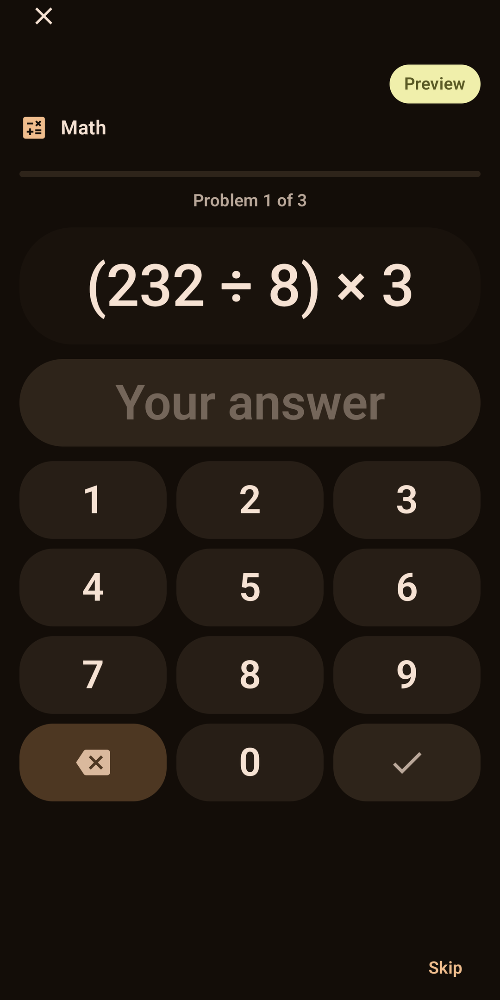
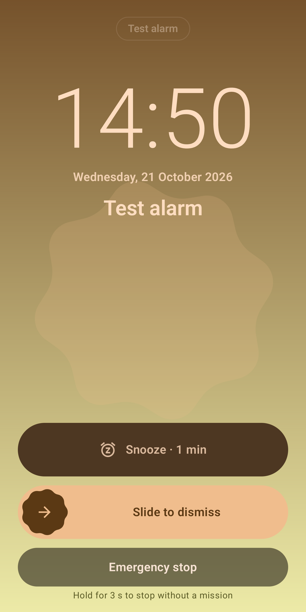
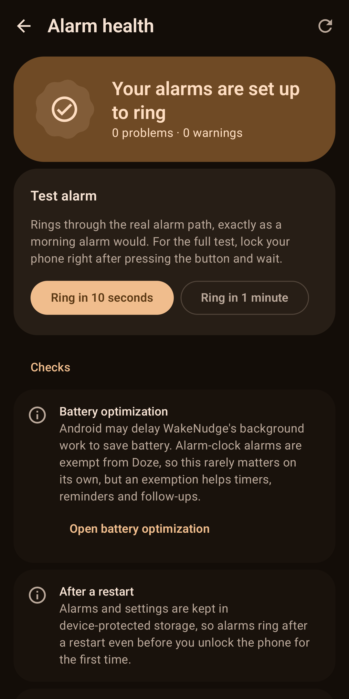
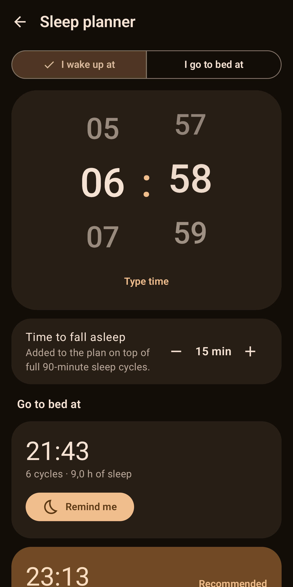
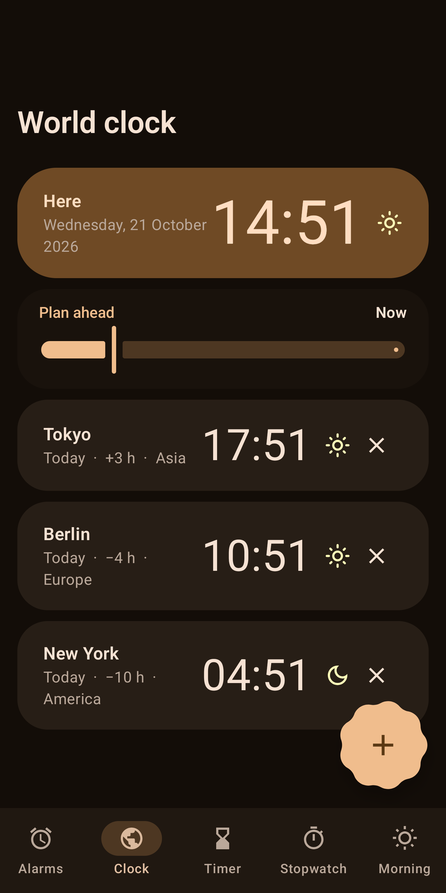

<p align="center">
  
</p>

<h1 align="center">WakeNudge: free open-source alarm clock for Android with wake-up missions</h1>

<p align="center">
  <strong>Solve a puzzle, scan a code or walk a few steps to switch it off.</strong><br>
  A reliable lock-screen alarm that checks you are really awake. Offline, no ads, no accounts, no tracking.
</p>

<p align="center">
  <a href="https://github.com/riyadmondol2006/WakeNudge/actions/workflows/ci.yml"></a>
  <a href="https://github.com/riyadmondol2006/WakeNudge/releases/latest"></a>
  <a href="LICENSE"></a>
  
  
  
  
  
</p>

<p align="center">
  <a href="https://wakenudge.site"><strong>Website</strong></a> ·
  <a href="#download">Download</a> ·
  <a href="#wake-up-missions">Missions</a> ·
  <a href="#screenshots">Screenshots</a> ·
  <a href="#what-it-cant-stop">Limits</a> ·
  <a href="#privacy">Privacy</a> ·
  <a href="#faq">FAQ</a> ·
  <a href="#build-from-source">Build</a>
</p>

---

**WakeNudge** is a free, open-source alarm clock app for Android, built for heavy sleepers, shift workers, students
and anyone who has slept through an alarm. To dismiss it you complete **wake-up missions**: math problems, a QR code
or NFC tag on the other side of the room, steps, a quick game and more. After you dismiss, a **"Still awake?" check** rings
again if you drifted back to sleep. A built-in **Alarm Health** screen and a real **test alarm** tell you whether your
phone is set up to ring.

Each alarm has one choice that sets everything else, **How hard?**:

| Level | What it means |
|---|---|
| **Easy** | Swipe to stop. You can snooze. Stops by itself after 10 minutes. |
| **Normal** (new alarms) | Finish a mission to stop. Snooze up to 3 times. Keeps ringing until you deal with it, and its screen comes back if you leave it. |
| **Hard** | No snooze, the loudest the phone allows, on the phone's own speaker. Checks you're still up a few minutes later. Can't be changed in the 8 hours before it rings. |
| **No mercy** | Hard, with two checks, Extra Loud and the strictest limits. |

Change any detail under More options and the alarm shows **Custom**. Every alarm keeps an **Emergency** button that pauses
it so you can make a call, a mission your phone cannot do is replaced by a **backup mission**, and alarms with a mission have
a **way out without the mission** (a 10-second hold on Normal; on Hard and No mercy it opens after 3 or 10 minutes of ringing
and takes 10 or 20 tasks). It runs on your phone, follows your wallpaper colours with Material You, and **everything is
free**: every mission, the still-awake check and the edit lock. No ads, no subscription, and features never go away.

## Download

| Where | Status |
|---|---|
| **GitHub Releases** (APK) | [**Download the latest APK**](https://github.com/riyadmondol2006/WakeNudge/releases/latest/download/WakeNudge.apk) (starts the download straight away), or browse the [latest release](https://github.com/riyadmondol2006/WakeNudge/releases/latest). Every release carries `WakeNudge-<version>.apk` (install this one), the same file as `WakeNudge.apk`, the R8 `mapping` file and `SHA256SUMS.txt`. |
| **Website** | [wakenudge.site](https://wakenudge.site): overview, screenshots, install steps and the privacy policy in one page. |

Needs **Android 8.0 (API 26) or newer**.

<details>
<summary><strong>How to install the APK and check the download</strong></summary>

1. On your phone, [download the latest APK](https://github.com/riyadmondol2006/WakeNudge/releases/latest/download/WakeNudge.apk) (or open the [latest release](https://github.com/riyadmondol2006/WakeNudge/releases/latest) and pick `WakeNudge-<version>.apk`; both are the same file).
2. Open the file. When Android asks, allow "Install unknown apps" for your browser or file manager.
3. Optional: download `SHA256SUMS.txt` next to the APK and compare, for example on a computer:

   ```bash
   sha256sum -c SHA256SUMS.txt --ignore-missing
   ```

4. Open WakeNudge, follow the short onboarding, then open **Alarm health** and ring the test alarm with your screen locked.

WakeNudge tells you when a newer release exists (see [Privacy](#privacy)). Updates are installed the same way, from the release page.
</details>

## Screenshots

Real captures from a Pixel 6 in the dark theme, taken before the How hard? levels were added: today the editor starts
with label, time, repeat, How hard?, mission and sound, and the ring screen puts the mission first. WakeNudge also has light
and AMOLED themes.

<p align="center">
  
  
  
  
</p>
<p align="center">
  
  
  
  
</p>

## What it does

| | |
|---|---|
| **Eleven wake-up missions** | Math, memory, typing, QR/barcode, NFC, shake, steps, squats, puzzles, photo matching and Focus Tap. Chain several, pick the difficulty, preview each one, or let the alarm ask for a different one each morning so none becomes a habit. |
| **Still-awake check** | Dismissed and went back to sleep? WakeNudge asks "Still awake?" a few minutes later and rings again if you do not answer. On Hard and No mercy a button isn't enough: you play a round of Focus Tap, or walk 30 steps. It survives restarts. |
| **Loud, then louder** | An **Extra Loud strength**, a volume ramp of up to 10 minutes, and a sound that intensifies after 40 seconds without interaction. From Normal up, turning the volume down while it rings doesn't stick. A separate **backup alarm** rings later if nothing happens. |
| **Hard to wriggle out of** | Snooze limits (optionally shrinking), hold-to-dismiss and an edit lock up to 12 hours before the alarm that also covers vacation, profiles, exception days and restoring a backup. Leave the alarm screen and it comes back in about a second, once you allow "Display over other apps". Restart the phone and the alarm rings again, at full volume with no snooze. A mission your phone cannot do (no camera, refused permission, a dead sensor, a black camera) is replaced by a **backup mission**, never skipped. **Settings, Protection** walks you through the setup, a rehearsal of the alarm and optional device admin, which stops a half-asleep force stop or uninstall. |
| **Always an exit** | **Emergency**, on every ring, pauses the alarm for a call. The way out without the mission is there unless you remove it yourself. See [What it can't stop](#what-it-cant-stop) for the rest. |
| **Alarm Health and test alarm** | Checks notifications, full-screen permission, exact alarms, battery restrictions, Do Not Disturb and audio routing, explains each fix, and rings a real test alarm. |
| **Offline, no ads, no tracking** | No accounts, no analytics, no ad SDKs. The only thing that goes online is the optional update check. See [Privacy](#privacy). |
| **Open source** | Apache License 2.0, Kotlin and Jetpack Compose, with a large automated test suite. |
| **Material You design** | Dynamic colour, light, dark and AMOLED themes, large-text and right-to-left support, TalkBack labels, layouts that adapt to the window size. Alarm options are grouped into collapsible categories with a one-line summary of each, and Settings is a short grouped list. |

### Wake-up missions

Missions are completed in order, or one per morning in turn with "Change the mission each morning". Count and difficulty
are set per alarm. A mission the phone cannot do (no camera, no
step sensor, a camera that shows only black, permission refused, NFC off) is replaced by a **backup mission**: a few
short tasks (Focus Tap, typing a phrase, simple sums), longer when the cause is one you could fix. It is never skipped.

| Mission | What you do | Needs |
|---|---|---|
| Math | Solve arithmetic on a big built-in keypad: easy is like 7 + 5, medium 27 + 6 or 7 × 4, hard 38 + 47 or 7 × 8 + 23 | |
| Memory | Watch tiles light up, then repeat the pattern as it grows | |
| Typing | Type a short phrase as shown (curly quotes and long dashes from your keyboard count as the plain ones) | |
| QR code or barcode | Scan a code you registered away from your bed | Camera |
| NFC tag | Tap an NFC tag you placed away from your bed | NFC |
| Shake | Shake the phone until the counter is full | Accelerometer |
| Steps | Walk a number of steps, counted on the phone | Step counter or motion sensor |
| Squats | Do squats while holding the phone against your chest | Accelerometer |
| Puzzle | Slide tiles into order on a 3 × 3 board, find the numbers one to N, or trace a pattern | |
| Photo | Go to a place you photographed and point the camera at it (matched on the phone) | Camera |
| Focus Tap | Shapes come and go on a 3 × 3 board; tap only the one asked for. A wrong tap starts the round again | |

A heavy-sleeper setup that works well: **Hard**, with a **QR code or NFC tag** on something you use next, in another room
(so you must leave the bed). With a screen reader, Switch Access or Voice Access every mission waits for you instead of
timing you, and "I can't do timed or physical missions" (Settings, Look and feel) leaves the motion and timed ones out.

<details>
<summary><strong>Everything else it does</strong></summary>

**Alarms and schedules**
- Unlimited alarms with labels, repeat days, one-time dates and delete-after-use
- Profiles (Work, Weekend, ...), skip next ring, vacation mode, holiday and calendar exceptions, upcoming-alarm heads-up
- Each alarm is **Easy, Normal, Hard or No mercy**, each explained in one line; the rest is under More options in collapsible groups (volume and vibration, snooze, stopping it, if I try to get out of it, voice and light, still up?, schedule rules) with a live summary of each; settings is a grouped hub
- Bedtime reminders and a sleep planner (wake-up time or bedtime from 90-minute sleep cycles)
- A morning dashboard with history and streaks, and "How it went": the backup mission, way outs, missed rings, Emergency
  pauses, restarts and mutes, this morning and over the last week, counted on the phone
- About 8 hours before the next alarm, an evening check that it will really ring (trigger, permissions, Do Not Disturb,
  a low battery that isn't charging, every mission's setup); silent when all is well. When an alarm rang late or not at
  all, the next start says why if the phone can still tell

**Sound**
- 12 bundled tones in gentle, standard and loud tiers, each loudness-normalised to its target level (plus two internal ones for the intensify layer and backup alarms), or your own local music. Tapping a tone plays it right away
- Random tone per ring, strong vibration patterns or your own recorded rhythm
- Offline spoken announcements with the phone's text-to-speech engine
- Sunrise mode (the screen brightens gradually), a separate backup alarm, and an optional torch that flashes once a second
  when an alarm is ignored
- Hearing safety: a configurable volume cap on headphones, and the system alarm volume is restored afterwards

**Clock tools**
- Timer, stopwatch with laps, world clock, live countdown to the next alarm
- Home-screen widgets (next alarm, alarm list, clock) and a Quick Settings tile

**Data**
- Local backup and restore to a JSON file you choose, with validation and a preview before anything is replaced
</details>

## How it stays reliable

An alarm clock is judged on the one morning it fails, so this is where most of the engineering went.

- Uses the system alarm-clock API (`AlarmManager.setAlarmClock`), plays on the alarm audio stream (`USAGE_ALARM`), and runs a foreground service with a full-screen ring UI over the lock screen.
- State lives in device-protected storage, so alarms can ring after a restart before the first unlock (designed and
  tested in simulation; not yet seen on a phone with a PIN).
- Re-arms everything after reboots, app updates, time-zone and daylight-saving changes, and on the next start after a
  force stop (which makes Android forget every alarm without telling the app). Snoozes, backup rings and the still-awake
  check are saved, not just held in memory.
- A ring outlives its process. What it must not lose (the alarm as it fired, the snoozes used, the missions done) is
  saved outside the database. On the test Pixel 6: restarted mid-ring, the sound was back 21 to 23 seconds after the phone
  finished starting, at full volume with no snooze; stopped from Active apps, it was back after 17 seconds.
- Leave the ring screen while it rings and, with "Display over other apps" allowed, it is back in about 1.2 seconds from
  Home or Recents. Leave it again and again and it backs off a little: swiping its card away for the fourth time in a row
  brought it back after about 5.5 seconds. Nothing is drawn over other apps, and it is not brought back over a call, the
  lock screen or a permission dialog. Without the permission the notification alerts again instead. An alarm with a volume floor can't be turned down below it while
  it rings.
- One corrupt alarm cannot stop the others; the app stays under the OS limit of 500 alarms; a 6-hour watchdog re-validates
  the schedule. A fallback chain (your sound, then the default tone, then a generated beep) means a deleted song still
  produces sound.
- Over a thousand unit, fuzz and instrumented tests, including "how will real people break it?" suites and one that fails
  if any ring has no way to end. Details in [docs/TESTING.md](docs/TESTING.md) and [docs/ARCHITECTURE.md](docs/ARCHITECTURE.md).

## What it can't stop

WakeNudge makes getting back to sleep hard. It can't make it impossible, and no Android app can.

- **Power off isn't blocked.** Holding the power button, the power menu or a voice assistant can switch the phone off or
  restart it, and holding the power button long enough restarts any Android phone. What WakeNudge does instead: after a
  restart the alarm rings again at full volume with no snooze, up to 3 times on Easy and Normal, 5 on Hard and 10 on No
  mercy, for up to 10 minutes (Easy), 2 hours (Normal) or 12 hours (Hard, No mercy) after it first rang. A phone that
  stays off can't ring.
- **Without "Display over other apps"**, pressing Home leaves the alarm screen. The sound keeps going and the notification
  comes back. On tablets and foldables Android may let the alarm share the screen with another app.
- **Force stop and uninstall** are blocked only while you have switched on device admin (Settings, Protection, after a
  rehearsal). Then uninstalling is refused, and App info's Force stop button still looks enabled but does nothing. You can
  switch device admin off in WakeNudge's Protection screen whenever no alarm rings or is snoozed, or at any time in
  Android's Settings, Security, Device admin apps. Without it, a force stop silences the alarm until you next open the app;
  Stop in Active apps doesn't, because the alarm comes back on its own.
- **Safe mode, a factory reset, a computer with USB debugging** and **a flat battery** all beat it.
- **Do Not Disturb set to Total Silence** can silence alarms, and Android doesn't let apps override it. **Extreme Battery
  Saver** pauses apps you haven't chosen as essential. Alarm Health warns you about both.
- **A phone or video call** keeps the alarm quiet while it lasts (a call in an app for at most 10 minutes per ring).
- **A QR code or NFC tag kept by your bed** defeats the point. It only works somewhere you have to walk to. A photo of a
  photo can pass the photo mission, and shaking can pass for steps.
- **Any single mission can become a habit.** People learn to do sums half asleep. Change the mission each morning, or use
  a target in another room.
- **You can still go back to bed.** The still-awake check makes that harder, but it can be fooled.
- **There's a way out unless you remove it.** Every alarm with a mission has one by default. On Hard and No mercy it takes
  minutes and a long run of tasks. If you remove it and lose your code, the only ways to stop the alarm are restarting the
  phone repeatedly or Safe mode.
- **Don't use Hard or No mercy for a time you may be driving.**
- **Emergency is on every ring.** It pauses the alarm for 3 minutes and opens the phone app, or the unlock screen with its
  Emergency call button when the phone is locked. The alarm screen is never brought back over the lock screen.
- **A phone left at home keeps ringing** until the battery runs out, unless you use Easy.
- **The edit lock can be unlocked** by doing the alarm's own mission before it rings (Hard and No mercy), and anything can
  be changed outside the lock window.
- **Tested on one phone**, a Pixel 6 on Android 17 with gesture navigation. Other phones may kill apps in ways this can't
  see. Samsung, Xiaomi, OnePlus, other Android versions, three-button navigation and a TalkBack walkthrough are on the
  "not verified" list in [docs/TESTING.md](docs/TESTING.md). Please run the test alarm on your own phone and
  [report what you find](https://github.com/riyadmondol2006/WakeNudge/issues/new/choose).

## Privacy

No accounts, no ads, no analytics, no crash reporting, no tracking SDKs. Alarms, history and settings are stored
only in the app's private storage on your phone. Permissions such as camera, step counter and calendar are requested
only when you use the feature that needs them ([every permission, and why](docs/PERMISSIONS.md)).

WakeNudge holds one network permission, `INTERNET`, for an **update popup** that checks GitHub at most once an hour for
a newer release. It sends nothing about you or your alarms, and you can switch it off in **About, then Updates**. Read
the full [privacy policy](PRIVACY.md).

## Why another alarm app?

WakeNudge aims to be a reliable alarm with real wake-up missions, an exit that is always there for an emergency, and code
you can read, build and audit yourself, with every feature free. It is made by one developer, with original code, sounds
and artwork.

## FAQ

<details>
<summary><strong>Is it really free and open source?</strong></summary>

Yes. Apache License 2.0, no ads, no subscription, no in-app purchases, no account. The whole app is in this repository.
</details>

<details>
<summary><strong>Is it really offline?</strong></summary>

The alarm clock never needs the internet. The app holds only `INTERNET`, used for the optional update popup described
under [Privacy](#privacy); switch it off in About, then Updates, and WakeNudge never goes online. The Gradle
`verifyOfflineManifest*` tasks fail the build if any other network permission (`ACCESS_NETWORK_STATE`,
`ACCESS_WIFI_STATE`) appears.
</details>

<details>
<summary><strong>Will the alarm ring if my phone is switched off?</strong></summary>

No app can. If the phone was off when an alarm was due, WakeNudge rings when it starts again if the alarm was due within
the last 10 minutes, or within the alarm's own window (2 hours on Normal, 12 hours on Hard and No mercy); otherwise it
records the alarm as missed, posts a notification and turns a one-time alarm off. Switched off or restarted while it
rings, the alarm rings again when the phone is back (see [What it can't stop](#what-it-cant-stop)).
</details>

<details>
<summary><strong>Does it work on Samsung, Xiaomi, OnePlus and other phones?</strong></summary>

It uses Android's standard alarm-clock APIs, but it has only been tested on hardware on a Pixel 6 (Android 17).
Some manufacturers add battery managers that can still stop background work. Open **Alarm health**, follow its
fixes, set WakeNudge's battery usage to unrestricted if your phone has such a setting, ring the **test alarm** with the
screen locked, and report the result.
</details>

<details>
<summary><strong>I am a heavy sleeper. What should I turn on?</strong></summary>

Pick **Hard** (or No mercy) and a mission that makes you leave the bed: a QR code or NFC tag on something you use next, in
another room. Then open **Settings, Protection** and do its steps, including "Try it now", a rehearsal of the alarm. No app
can promise a wake-up, but this removes the easy ways to fail.
</details>

<details>
<summary><strong>Can a mission trap me?</strong></summary>

Not unless you ask it to. Every ring and mission screen has an **Emergency** button: it pauses the alarm for three minutes
and opens the phone app (on a locked phone, the unlock screen with its Emergency call button). A mission the phone cannot
perform is replaced by a backup mission of a few short tasks. And there is a way out without the mission: hold for 10
seconds, or, on a Hard or No mercy alarm, 10 or 20 tasks that open after 3 or 10 minutes of ringing. If you remove the way
out yourself (only possible after a rehearsal of that alarm), the backup mission, restarting the phone up to the alarm's
limit and Safe mode are what is left.
</details>

<details>
<summary><strong>How do updates work?</strong></summary>

WakeNudge shows a popup when a newer release exists and you install it from the release page; you can switch the
check off in About, then Updates. The check contacts GitHub at most once an hour and sends nothing about you or your
alarms.
</details>

<details>
<summary><strong>Which Android versions and languages are supported?</strong></summary>

Android 8.0 (API 26) and newer; the target is Android 17 (API 37). The interface is in English.
</details>

## Build from source

Requirements: JDK 21 and the Android SDK (platform 37), or an Android Studio release that supports Android Gradle Plugin 9.4.

```bash
git clone https://github.com/riyadmondol2006/WakeNudge.git
cd WakeNudge
./gradlew :app:assembleDebug             # app/build/outputs/apk/debug/
./gradlew :app:testDebugUnitTest         # JVM unit and fuzz tests
./gradlew :app:lintDebug                 # lint (must be free of errors)
./gradlew :app:verifyOfflineManifestDebug   # fails if a network permission other than INTERNET appears
```

Use `assembleRelease` for a minified release APK. Debug builds install as
`com.riyadm.wakenudge.debug` ("WakeNudge Debug") next to a release install. Release signing and the release process are
described in [docs/RELEASING.md](docs/RELEASING.md).

### Instrumented tests

> **If several devices are connected, do not run `./gradlew connectedDebugAndroidTest`.** It installs on and runs
> against every attached device. Target exactly one:
>
> ```bash
> adb -s <SERIAL> install -r -t app/build/outputs/apk/debug/app-debug.apk
> adb -s <SERIAL> install -r -t app/build/outputs/apk/androidTest/debug/app-debug-androidTest.apk
> adb -s <SERIAL> shell am instrument -w -r com.riyadm.wakenudge.debug.test/com.riyadm.wakenudge.HiltTestRunner
> ```

The tests ring real alarms and use real audio. Use a test device, not the phone you sleep with.

## Project layout

```
app/src/main/java/com/riyadm/wakenudge/
  domain/    models, scheduling policies (pure Kotlin), use cases
  data/      Room, DataStore, repositories, backup
  engine/    scheduler, ring controller/service, audio, wake-check, timers, recovery
  missions/  the eleven mission types and their host
  health/    Alarm Health checks and diagnostics export
  widget/    Glance widgets          tile/  Quick Settings tile
  ui/        Compose screens, theme, components
  update/    the optional check for a newer release on GitHub
docs/        documentation
```

Built with Kotlin, Jetpack Compose, Material 3, Hilt, Room, DataStore, Glance, CameraX and ZXing core.
More in [docs/ARCHITECTURE.md](docs/ARCHITECTURE.md).

## Documentation

| | |
|---|---|
| [docs/ARCHITECTURE.md](docs/ARCHITECTURE.md) | How alarms are scheduled, rung and recovered |
| [docs/TESTING.md](docs/TESTING.md) | Test strategy, what was verified on a device, what was not |
| [docs/PERMISSIONS.md](docs/PERMISSIONS.md) | Every permission, why it exists and when it is asked for |
| [PRIVACY.md](PRIVACY.md) | Privacy policy |
| [CONTRIBUTING.md](CONTRIBUTING.md) | How to contribute |
| [SECURITY.md](SECURITY.md) | How to report a vulnerability privately |
| [CHANGELOG.md](CHANGELOG.md) | Release notes |

## Contributing

Bug reports about an alarm that did not ring are the most valuable contribution: please include your phone model,
Android version, vendor skin and the **Alarm Health** report (Alarm Health, then Copy). Read [CONTRIBUTING.md](CONTRIBUTING.md)
for the ground rules (stay offline, a mission must never trap the user, restore what you change) and the checks a pull
request must pass. Everyone taking part is expected to follow the [Code of Conduct](CODE_OF_CONDUCT.md).

If WakeNudge works for you, a star on the repository helps others find it.

## License

Apache License 2.0. See [LICENSE](LICENSE) and [NOTICE](NOTICE). To cite the project, see [CITATION.cff](CITATION.cff).
